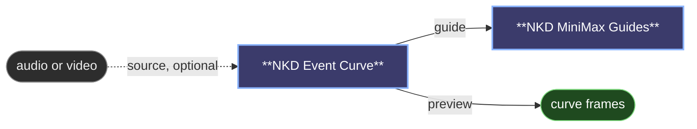

# 😺NKD Event Curve

Draw when things happen in a MiniMax H3 video. Ask for a dog jumping, draw three
peaks, get three jumps.

Plug `guide` into frame 0 of [😺NKD MiniMax Guides](minimax-guides.md) (or Add
Guide for MiniMax H3) and match `length` and `fps` to your video.

- **`guide`**: the kind of action. Pick the one closest to what the prompt
  describes:
  - **P (punch)**: sharp single events: bounces, steps, hits.
  - **F (flow)**: gradual intensity: lights, wind, water.
  - **M (motor)**: something revving, harder as the curve rises: engines,
    acceleration.
  - **B (blast)**: a bang on each rise that lasts while the curve stays on:
    explosions, gunshots, thunder.
  - **U (uncanny)**: a pulsing effect, faster as the curve rises: UFOs, magic,
    sci-fi.
  - **W (words)**: someone talking where the curve is up; the higher it is, the
    faster the words come. Give it a low `until` in MiniMax Guides (around 0.2)
    so it only sets the timing of the dialogue.
- **`shape`**: draw your own curve with `custom`, or repeat a sine, square,
  triangle, sawtooth or pulses with `cycles` and `phase`.
- **On the curve**: click to add a point, drag to move it, right-click to delete,
  double-click for a sharp corner. Switch to **Draw** to paint it freehand, and
  **Reduce** cleans it up afterwards.
- **`source`**: copy the timing from a song, a sound or another clip instead.
- **`strength`**: lower it if the result feels forced.
- **`preview`**: the curve with a moving playhead, to stack under your clip.

---

[← All 😺NKD Basic Tools nodes](../README.md)
