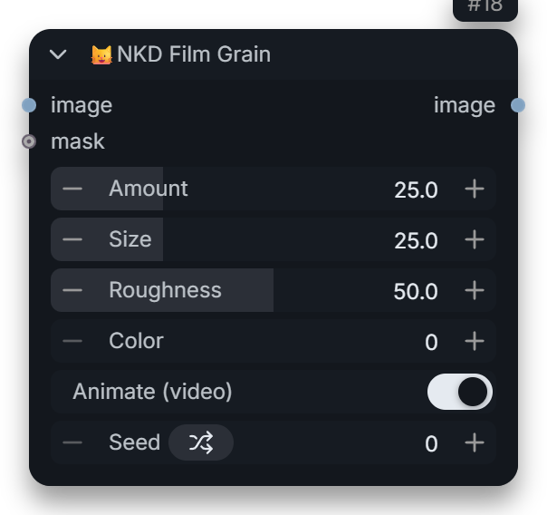

# 😺NKD Film Grain

Believable analog grain, closer to a Lightroom or Camera Raw feel.

- `Amount`, `Size` and `Roughness` shape the grain.
- It's monochrome by default; raise `Color` for dye-cloud color grain.
- The optional `mask` grains only part of the frame.

On a video batch each frame gets fresh grain, so it shimmers like real emulsion
instead of sitting frozen on top.

https://github.com/user-attachments/assets/250a156d-e95d-499d-8a18-61454e95802f

 

---

[← All 😺NKD Basic Tools nodes](../README.md)
