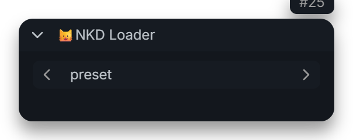

# 😺NKD Loader

One node that stands in for a set of loader nodes: a diffusion model, its text
encoders, the VAE, an upscaler, adapters. Save the set once, then switch model
families from a single dropdown instead of rewiring four loaders.

## Saving a preset

Select the loader nodes on the canvas, right-click and choose **Save as NKD Loader
preset**, then give it a name. Any loader works, from any pack. The loaders can
feed each other, but nothing in the selection may take an input from a node
outside it.

## Using it

Add 😺NKD Loader and pick a preset. Its outputs appear typed and named after the
loaders: model, clip and vae first, the rest in canvas order.

- Switching to another preset keeps your cables wherever an output keeps its
  type, so going from one model family to another leaves `MODEL`, `CLIP` and
  `VAE` wired.
- The workflow carries the preset itself, not just its name, so it runs on a
  machine that doesn't have the preset. If a loader node isn't installed there,
  the node says which one.
- Each loader in the preset still loads and caches its models as it always does.

## Editing a preset

Right-click the node and choose **Unpack NKD Loader**: the real loader nodes come
back in a group, still wired, so you can change a file or a setting. Right-click
the group and choose **Repack NKD Loader** to save it and fold it back into one
node. The output order and names stay as they were.

**Convert NKD Loader to subgraph** unpacks into a subgraph instead, with every
loader setting exposed as a widget on the subgraph node (**… for sharing** leaves
the settings inside, so the node shows only its outputs).

Rename, reorder or delete presets under **Settings → NKD → Loader**.
Deleting a preset doesn't break the workflows that use it.

## Sharing a workflow that uses a preset

Under **Settings → NKD → Loader**, open a preset with the sliders button: every
model file has a **download link** field. Paste the file's direct download
address — `https://huggingface.co/<repo>/resolve/main/<path>` or the Civitai
`api/download` link, not the page it sits on — and the preset remembers it. A
link already declared on the loader node you captured is picked up on its own.

Before you share the workflow, right-click the node and choose **Convert NKD
Loader to subgraph for sharing**. The real loaders go inside a subgraph that
exposes the same outputs, so no cable moves, and each loader carries its download
links: whoever opens the workflow is offered the models it needs with a download
button, which a single opaque node can't do. The subgraph holds only the loaders
themselves, so the workflow opens and runs without NKD Basic Tools installed.

## Outputs

Up to 10 outputs, whatever the preset's loaders produce.

 

---

[← All 😺NKD Basic Tools nodes](../README.md)
