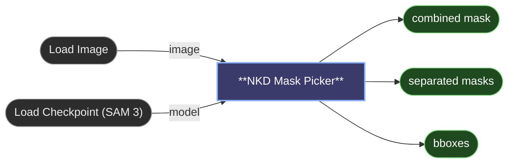

# 😺NKD Mask Picker

Pick objects for a mask by pointing at them. Press **Analyze** and the node finds
every object it can in the image. Then hover the preview on the node to see what's
under the cursor, and click to pick it. No prompt to write, no ids to read off a
list.

## Model

Load a SAM 3 or SAM 3.1 checkpoint with Load Checkpoint and wire its `model` output
into the node. ComfyUI's native SAM3 support does the work. The default `vitmatte`
edges also use ViTMatte, downloaded once (see [Edges](#edges)). In our tests a
quantized SAM 3.1 checkpoint found fewer small parts (glasses, for one) than the
full SAM 3.

## Controls

- **Analyze** runs the node on its own and shows the image with its objects ready
  to pick. Press it again after a reload or when the image changes.
- Hovering highlights the smallest object under the cursor. Whole figures that SAM
  is unsure about, common in busy or stylized images, are still listed when they
  cover over 1 % of the image: reach them with the wheel.
- The mouse wheel steps to a bigger or smaller object under the cursor. While the
  cursor is over an object, the wheel doesn't zoom the graph.
- Click picks the highlighted object. Click a picked object again to unpick it.
- Shift adds: Shift+click picks an object and never unpicks.
- Alt cuts holes: Alt+click takes the object's area out of what is already
  marked. Where nothing is marked, Alt does nothing.
- Drag across objects to pick every one the cursor highlights on the way. A drag
  never unpicks, and its objects come out as one entry of `separated masks` and
  one box of `bboxes`. Alt+drag cuts every object it crosses out of the selection
  instead.
- Click where nothing is highlighted to make SAM look there, or drag across it to
  give SAM several points of the same object (one every few pixels of travel, up
  to 8). The node analyzes again on its own and the new object shows up with its
  three sizes, like any other; the dots mark where you pointed. These spots stay
  until **✕**, also when the image changes.
- **✕** clears every pick.
- **Image / Mask** switches the preview between the photo and the mask you've built.
  On the photo, dimmed so the picks stand out, each drag or points object has its
  own colour.
- The full-screen button opens the same picker in a large view, with the photo at
  up to 2048 px.

Picks are saved with the workflow and survive reloads. When the image changes,
picks that no longer match an object are usually skipped, with a warning in the
console; clear them with **✕** to be sure.

Inside a subgraph, **Analyze** runs the whole workflow instead of just this node,
so clicking where nothing is listed only marks the spot: press **Analyze** yourself.

## Points mode

`points_only` turns the preview into a point editor, for busy images with odd
objects that the automatic search splits up or misses. No objects are listed: you
place SAM's points yourself, and each object's points make one mask.

- Click adds a positive point, right click or Alt+click a negative one.
- Drag a point to move it. Right click a point to delete it.
- **+ Object** starts another object; the next points make their own mask, its own
  entry of `separated masks` and its own box. Without it, every point is one object.
  Clicking a point makes its object the current one, ringed in white.
- **Live** (on by default) analyzes after every change and shows the mask. Off,
  only the points show until you press **Analyze** or run the workflow.

SAM picks the most confident of its three sizes for each object.

## Edges

`edges` picks how the edge of each picked object is made, and shows only its own
setting:

- `vitmatte` (default) mattes each object's edge with ViTMatte, so hair, fur and
  soft borders come out as a soft mask instead of a hard cut. `edge_margin` sets
  how far past SAM's edge the matte may look, as a fraction of the object's size:
  raise it for hair and fur that SAM missed, lower it if low-contrast parts smudge
  into the background. Before the matte, SAM re-segments each object twice in a
  crop around it. It costs about 0.2 s per object, and the first run downloads the
  model (99 MB) into `models/vitmatte`.
- `sam` keeps SAM's hard edge. `refine_iterations` (default 2) re-segments each
  picked object in a crop around it, the same passes as SAM3 Detect's option. The
  first pass costs about 0.1 s per object and each extra pass a few hundredths
  more; 0 gives the mask exactly as previewed.

ViTMatte is made for foreground objects. A large background pick (over a quarter
of the image, touching two or more image borders) is matted from the other side, as
everything else in the image. Smaller background patches can still come out
wrong, so use `sam` for those.

Either way, small stray specks are removed from the picked masks. The objects of
one drag are joined into a single object before their edge is made, so a sofa
picked with its cushions has no seams where the pieces touch: thin gaps between
them and small holes are filled, large holes stay.

## Detail

`detail` sets how many objects Analyze lists, and applies on the next Analyze.
Higher finds smaller parts and odder zones, doubtful ones too, and gives the
wheel more sizes to step through. On three test photos:

| detail | objects | Analyze |
|---|---|---|
| `low` | 10 to 16 | 0.2 s |
| `normal` (default) | 16 to 22 | 0.2 s |
| `high` | 25 to 34 | 0.2 s |
| `max` | 67 to 127 | 0.9 s |

Past `max`, SAM's automatic search has nothing more to give: for a zone it still
misses, use `points_only`.

## Outputs

- `combined mask` is every pick in one mask, with the cuts applied.
- `separated masks` is one mask per object you added, or per drag, as a batch,
  with the cuts made after it applied. An object cut away entirely is left out.
  Wired into 😺NKD Inpaint Crop, each mask gets its own crop.
- `bboxes` is one box per added object or drag, as a native `BOUNDING_BOX`. With `vitmatte`
  the box is taken where the mask is at least 0.5, so faint hair beyond that can
  fall outside it.

## Speed

Measured on an RTX 5090 with ComfyUI 0.42 and frontend 1.57:

- Analyze with the model already loaded takes about 0.2 s, 0.9 s at `detail` max
  (see the table above). The first Analyze also loads SAM 3, which adds a few
  seconds.
- Analyze again with nothing changed is instant, and brings the preview back.
- Hover is worked out in the browser, about 0.1 ms per mouse move, so the server
  does nothing while you move.

## App Mode

The picker shows in the app panel, and Analyze and Run both work there. It also
works in both node renderers, classic and Nodes 2.0.

## Batches and pipelines

Mask Picker is for choosing by hand, one image at a time. For batches and
automatic pipelines, where nobody is there to click, use ComfyUI's SAM3 Detect
with a text prompt.

## Credits

SAM 3 is by Meta. The node uses ComfyUI's native implementation of it.
[ViTMatte](https://github.com/hustvl/ViTMatte) is by hustvl (Apache-2.0); the node
runs `hustvl/vitmatte-small-composition-1k` through Hugging Face Transformers.

---

[← All 😺NKD Basic Tools nodes](../README.md)
