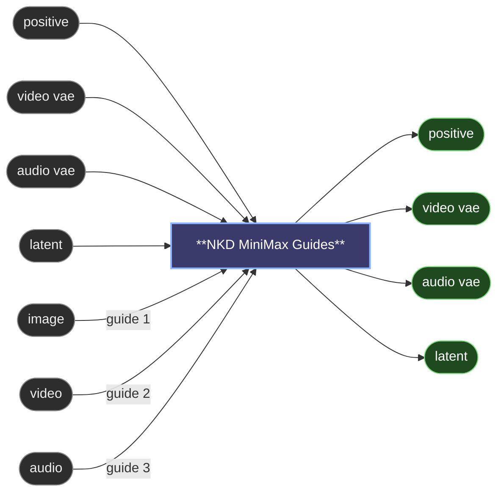

# 😺NKD MiniMax Guides

Every guide of a MiniMax H3 shot in one node, instead of a row of **Add Guide for
MiniMax H3** nodes all dragging the same four cables across the canvas.

- **Guides**: the list grows as you fill it. Each slot takes a still, a frame
  sequence, a video with its sound, or just audio.
- **`position`**: the frame each guide lands on. Negative numbers count from the
  end, and `-1` is the last frame: put the opening image there and the shot loops.
- **Same position**: a clip and a sound on the same frame become one guide, and two
  sounds get mixed, so two [😺NKD Event Curve](event-curve.md) guides can share
  frame 0.
- **`snap positions`**: keeps every guide on a multiple of 17 (0, 17, 34, 51…),
  the only frames where H3 takes a guide cleanly. Anywhere else that frame
  flashes like a bad cut. On by default.
- **`until`**: how far into sampling each guide is obeyed (1 = all the way). Feed
  a first render as a guide with `until` around 0.85 and the model keeps its
  layout and motion, then finishes the detail on its own.
- **Outputs**: `latent` and both VAEs come straight back out, so the sampler
  hangs off this node instead of reaching back across the graph.

---

[← All 😺NKD Basic Tools nodes](../README.md)
