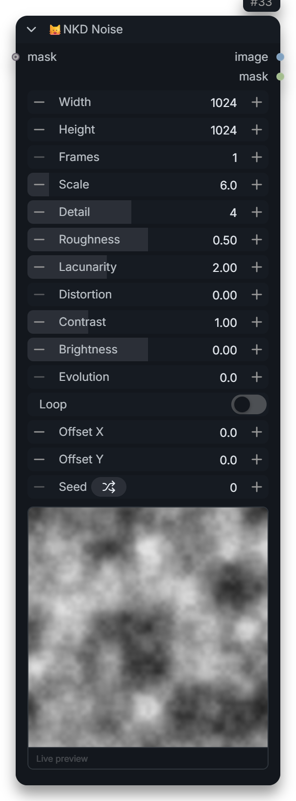

# 😺NKD Noise

Procedural fractal noise (fBm) for clouds, fog, smoke and organic textures, as an
image and as a mask.

- `Scale`, `Detail`, `Roughness`, `Lacunarity` and `Distortion` shape it.
- `Frames` + `Evolution` + `Loop` give you a seamlessly looping animated
  sequence.

Feed the output straight into [Gradient Map](gradient-map-generate.md) to tint it.

 

---

[← All 😺NKD Basic Tools nodes](../README.md)
