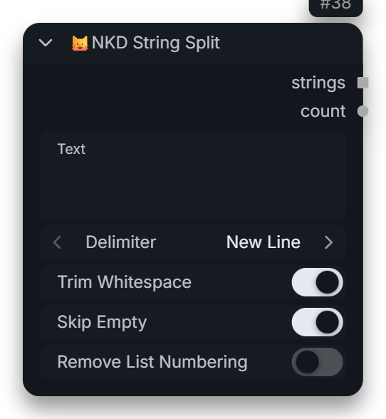

# 😺NKD String Split

Turns one block of text into a batch. It splits the text into a list of strings
and downstream nodes run once per item, so a list of prompts becomes N
generations with no extra wiring.

- Common delimiters plus a custom one.
- Whitespace trimming and empty-piece skipping.
- Optional removal of list numbering (`1.`, `2)`, `-`), for lists an LLM wrote.

The node shows the resulting list on itself, with partial execution so you can
iterate instantly.

 

---

[← All 😺NKD Basic Tools nodes](../README.md)
