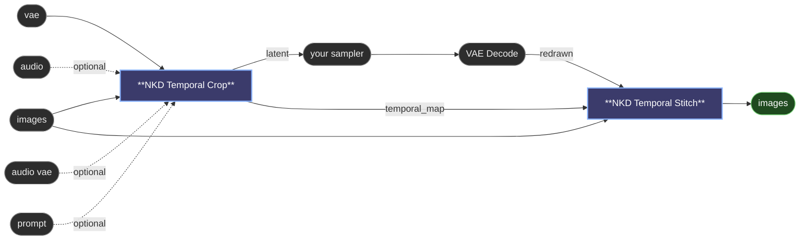

# 😺NKD Temporal Crop / Stitch

A detailer in time. Video models smear fast motion: a punch, a sword swing, a quick
turn. Mark those moments on the node's timeline and only they are redrawn, slowed down
so the model can draw every pose crisp, then put back at real speed over your video.

It works the way an inpaint crop does, turned on its side: cut out the moment, give
it room, redraw it, paste it back. The sampler in between is yours, with your model,
LoRAs and schedule.

## Temporal Crop

- **The timeline.** Run the node once and it shows your clip as a strip of
  thumbnails, with the soundtrack under it. Drag on the strip to mark a moment, drag
  its edges to adjust it, right click it to remove it. Hovering shows that frame large,
  so you can find exactly where the motion starts.
- **Nothing marked** means the video goes straight through and the sampler doesn't
  run. Mark, run again.
- **`Drawings`**: a new drawing every 1, 2 or 3 frames. **1** redraws every frame.
  **2** is animation on twos, each drawing held for two frames, and costs about half.
- **`Context`**: frames kept around each moment, untouched, so the model sees how the
  motion comes in and goes out and the paste has room to blend.
- The line under the timeline estimates how long the slowed clip will be. It turns
  orange past 15 seconds, the range most video models handle well: mark less, or use
  Drawings 2.
- **`audio` + `audio vae`** for models that make sound with the picture (MiniMax H3,
  LTX 2). The soundtrack is slowed with the picture so mouths keep following the voice,
  and it is kept, not redrawn. With the audio vae but no audio, it uses silence.
- **`prompt`**: shot times written as `At 00:01.200` are moved to match the slowed clip.

Outputs: the `latent` ready to sample, the slowed `images` and their `length` for
conditioning nodes that want pictures, the retimed `prompt`, and the `temporal_map` the
Stitch needs.

It reads the model's frame layout from the VAE you connect, so it works with any video
model: MiniMax H3, Wan, Hunyuan, LTX.

## Temporal Stitch

Takes the original frames, the `temporal_map` and the decoded result of the sampler.
Each redrawn moment comes back at real speed, with the sharpest frame of every drawing,
and is blended into the original across the context frames. Everything outside the
marked moments is the original video, untouched. Keep using your original soundtrack.

---

[← All 😺NKD Basic Tools nodes](../README.md)
